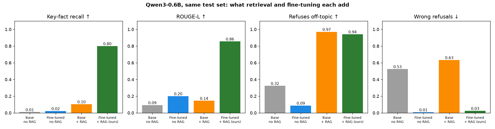
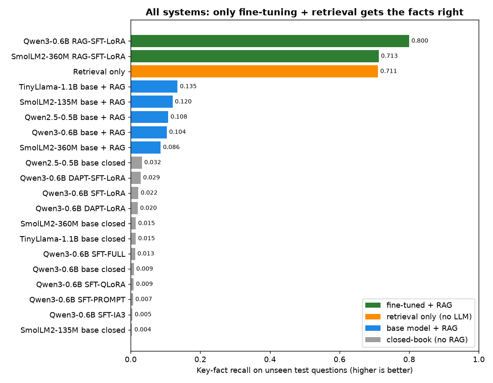
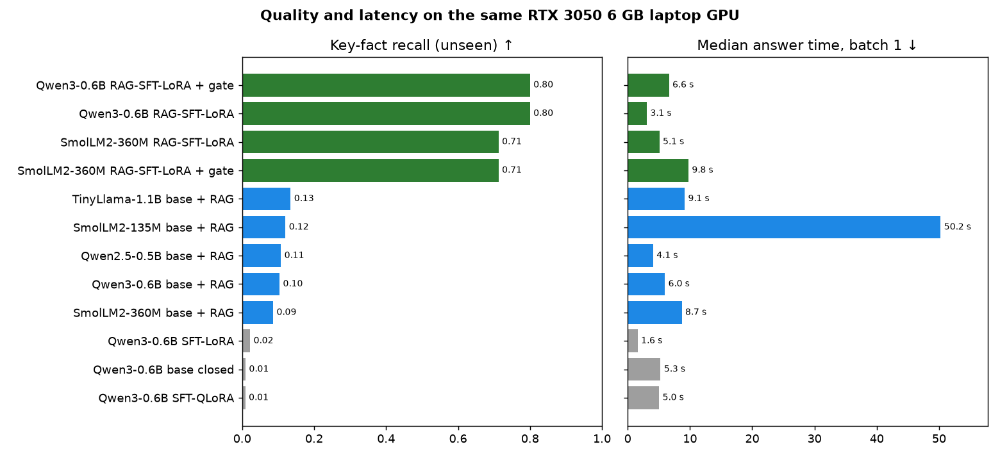
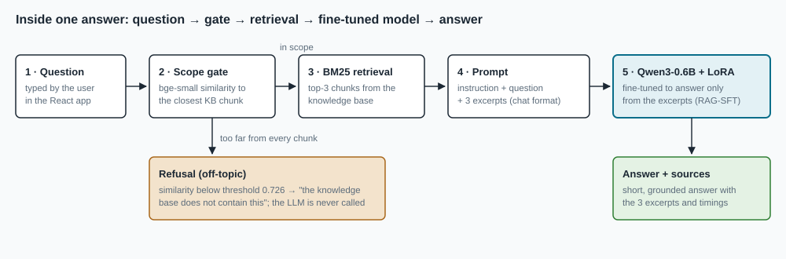
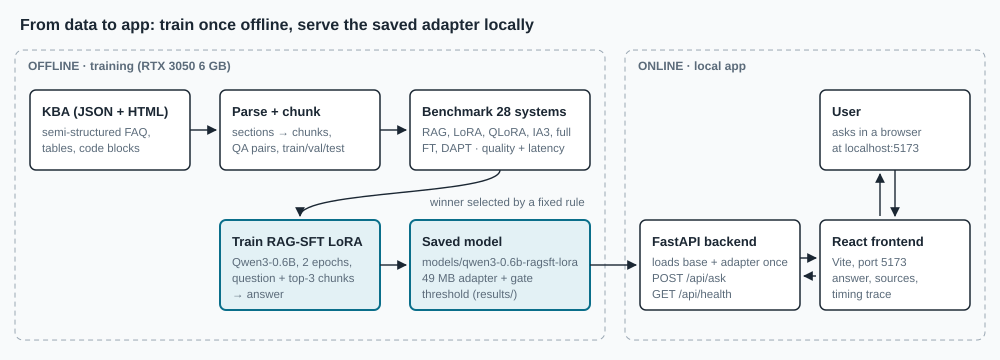
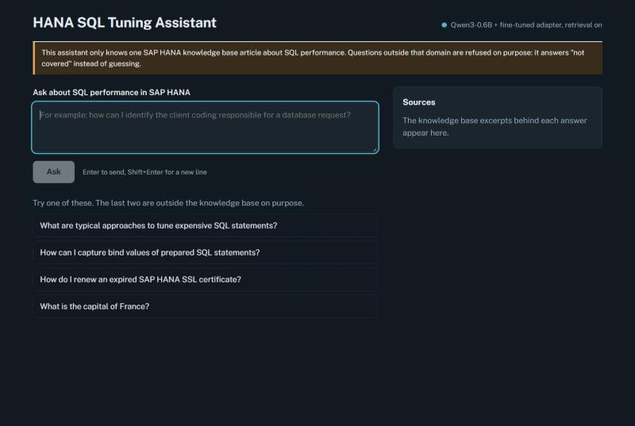
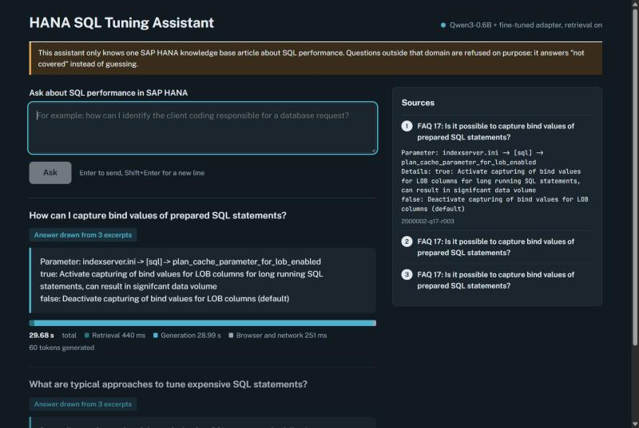
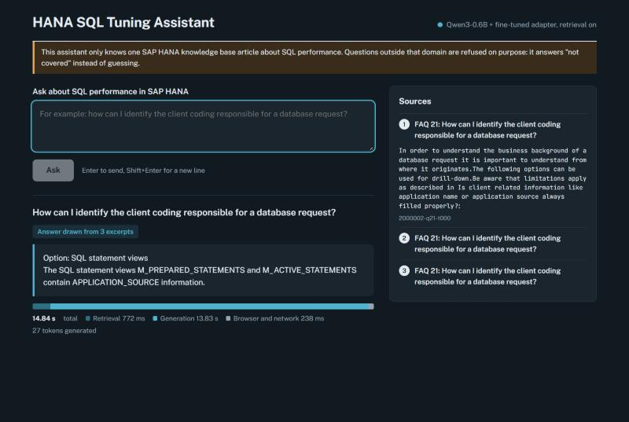
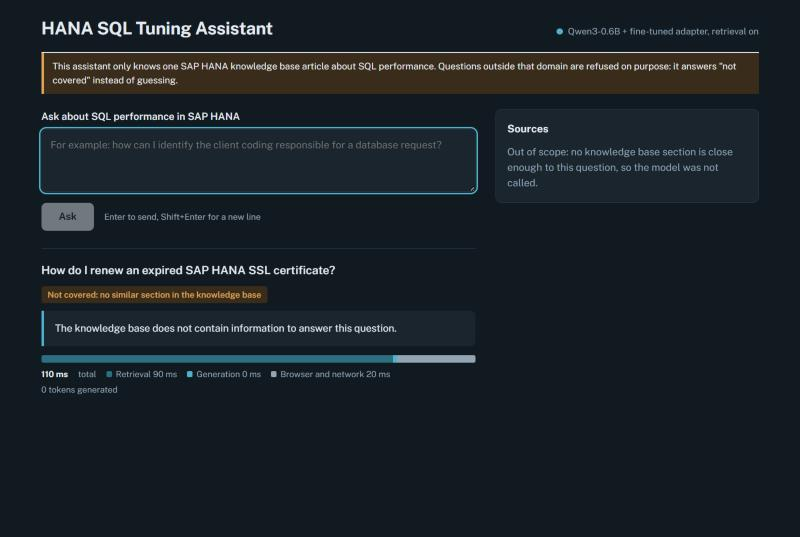
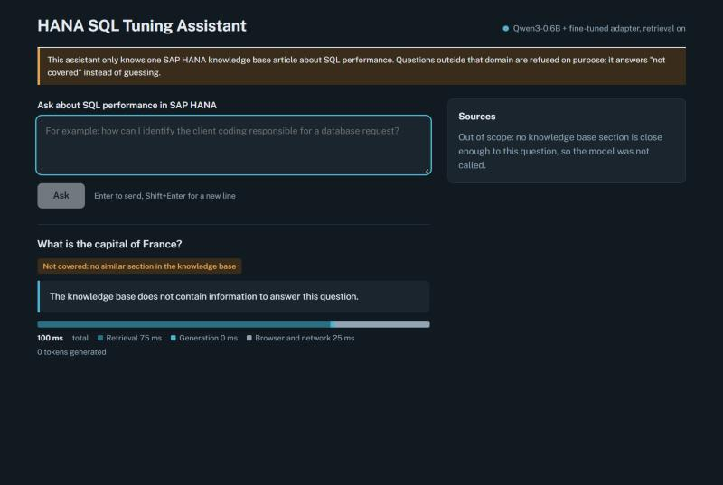

# SAP HANA Knowledge-Base Assistant: a Fine-Tuned 0.6B Model That Answers Only From the Docs

> **Want to see the app first?** Screenshots of the interface (input → output for 4 cases) are in [App demo](#app-demo), below the results.

## The problem

Support engineers lose time searching long SAP Knowledge Base Articles (KBAs) for one parameter, one SQL view,
or one setting. A general chatbot does not help: it does not know the article, and it **makes up** confident
answers. A support assistant has to answer only from the article, and say *"not covered"* when the article
has no answer.

The goal was to do that with **small open models (≤ 1.1 B parameters) on a 6 GB laptop GPU**: no paid API, and
no data leaving the machine.

**Data type:** one SAP HANA KBA about SQL performance, as **semi-structured JSON with embedded HTML**: FAQ
headings, paragraphs, parameter tables and SQL code blocks. The real document is SAP-owned and **not included
here**. Data, dataset and model details are in [docs/DETAILS.md](docs/DETAILS.md).

## The solution

**Retrieval + a fine-tuned small model + a scope gate:**

1. A **scope gate** checks whether the question is close to anything in the article. If not, the assistant
   refuses without calling the model.
2. **BM25 retrieval** picks the 3 most relevant chunks of the article.
3. **Qwen3-0.6B with a LoRA adapter** writes a short answer from those 3 chunks. It was fine-tuned on
   *question + retrieved chunks → answer*, which teaches it to use the excerpts instead of guessing (RAG-SFT).

Example of the format (illustrative, not taken from the KBA):

> **Q:** Which parameter controls X for long-running statements?<br>
> **A:** `indexserver.ini → [section] → parameter_x`. true: enable X (can produce large data volumes); false: disable X (default).<br>
> *Sources: 3 excerpts shown next to the answer.*
>
> **Q:** What is the capital of France?<br>
> **A:** The knowledge base does not contain information to answer this question.

## Our model

**Qwen3-0.6B + RAG-SFT (LoRA) + scope gate**, selected from 28 tested systems by a rule fixed before the results.

| | Result |
|---|---|
| Finds the key facts in the article | **80 %** of them, on questions it never saw in training |
| Refuses off-topic questions | **94 %** |
| Wrongly refuses real questions | 3 % |
| Runs on | a 6 GB laptop GPU (1.5 GB used), 49 MB adapter |

How the comparison was kept fair and how the winner was chosen: [docs/DETAILS.md](docs/DETAILS.md#how-the-systems-were-compared-and-selected).

## Comparison with the other approaches

**Same model, four setups:** retrieval alone or fine-tuning alone is not enough. Only the two together work.



**All 20 systems** (gate variants left out, since the gate does not change recall). Fine-tuning *without* retrieval
(LoRA, QLoRA, IA3, prompt tuning, full fine-tuning, domain pretraining) stays at or below 0.03 recall.



**Quality and speed:**



## How one answer is made



## System architecture

Train once offline, save the adapter, load it in the backend, and the user asks through the frontend.



## More results

- Selection rule, top-5 table and why the results matter: [docs/DETAILS.md](docs/DETAILS.md)
- All 28 systems with every metric: [results/comparison.md](results/comparison.md)

## App demo

The app runs **locally** (FastAPI backend + React frontend): the model and the article stay on the machine.
The source document is not in this repository, so you cannot test with the real data. The screenshots
below are from the real local app.



<table>
  <tr>
    <td width="50%"><b>1 · In-domain question</b><br>Input: <i>How can I capture bind values of prepared SQL statements?</i><br>Output: the exact parameter and its settings, with 3 sources<br></td>
    <td width="50%"><b>2 · In-domain question</b><br>Input: <i>How can I identify the client coding responsible for a database request?</i><br>Output: the SQL views that hold the information<br></td>
  </tr>
  <tr>
    <td><b>3 · Near the domain, not in the article</b><br>Input: <i>How do I renew an expired SAP HANA SSL certificate?</i><br>Output: refused in 0.1 s, the model is not called<br></td>
    <td><b>4 · Completely off-topic</b><br>Input: <i>What is the capital of France?</i><br>Output: refused, no guessing<br></td>
  </tr>
</table>

## How to run

Requirements: NVIDIA GPU with ≥ 4 GB VRAM, Python 3.12, [uv](https://docs.astral.sh/uv/), Node 20+.
You need your own knowledge-base JSON file in `raw data/` (the original is not shared).

```bash
uv sync
```

```bash
uv run python -m kbqa.run_experiments
```

```bash
uv run uvicorn backend.app:app --port 8000
```

```bash
npm --prefix frontend install
```

```bash
npm --prefix frontend run dev
```

1. `uv sync` installs the Python environment.
2. `run_experiments` runs the whole pipeline: parse, chunk, build QA, train, evaluate. This takes hours. The step-by-step
   modules are in [`src/kbqa/`](src/kbqa/).
3. Copy the selected adapter into `models/qwen3-0.6b-ragsft-lora/` (or set `KBQA_ADAPTER`), then start the API with `uvicorn`.
4. Install and start the frontend, then open http://localhost:5173.

To redraw the result figures from `results/comparison.csv`: `uv run python -m kbqa.make_figures`.

## Use it, ask me

Anyone is welcome to use or adapt this code for their own knowledge base. For questions or feedback, contact me
through my portfolio: **[ubaidur404786.github.io](https://ubaidur404786.github.io/)**.
